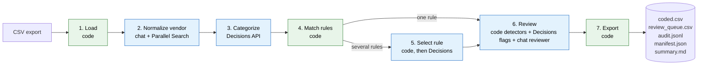

# spendcoder

[](https://github.com/ansh-shah/spendcoder/actions/workflows/ci.yml)


spendcoder turns a raw corporate-card export into GL-coded transactions using your accounting policy: categories, a rule matrix, and vendor overrides. Every row gets an audit trail, and uncertain rows go to a review queue.

It was designed around [Airbase](https://www.airbase.com/) transaction exports, and the `blank` template ships with the Airbase column mapping. Nothing in the pipeline depends on Airbase, though: any card export with an ID, a merchant description, and an amount works after you map its headers in `spendcoder.toml` (see [Input formats](#input-formats)).

The design rule is that models make judgments and code makes decisions. Arithmetic, eligibility, amount ranges, department exclusions, GL pairs, and row/ID preservation are plain code. Models answer small, bounded questions, and every answer is validated before use.

## Why

Month-end card coding is tedious. A person reads a few hundred lines like `SQ *HARBOR GRILL 0342`, decides what was bought, then picks the right GL account from a policy that depends on department, amount, and what the cardholder wrote in the memo.

Asking an LLM to do the whole job in one prompt is fast but hard to audit. It can invent a GL code, misapply an amount threshold, or drop a row without saying so. spendcoder splits the job so judgment calls go to models and policy enforcement stays in code you can read and test. The project started from a real month-end workflow and was rebuilt to be generic.

## Pipeline



| # | Stage | What decides | What it does |
|---|-------|--------------|--------------|
| 1 | Load | Code | Maps your headers to canonical fields, rejects duplicate or empty IDs and unparseable amounts. |
| 2 | Normalize vendor | Chat model, Parallel Search | Cleans descriptors with a strict JSON schema, batched over unique description and note pairs. Unknown merchants get web excerpts as evidence when search is enabled. |
| 3 | Categorize | Decisions API | One `choice` question over your categories plus Unknown. Below `category_min_confidence` the row stays Unknown. Vendor overrides win first. |
| 4 | Match rules | Code | Category, department, excluded departments, and amount range produce the eligible rules. One eligible rule is final. |
| 5 | Select rule | Code, then Decisions | Literal keyword match against the note first, then the single no-keyword default, then a `choice` limited to the eligible rules. |
| 6 | Review | Code, Decisions, chat | Detectors and your own yes/no flags group suspect rows. A reviewer may keep, change to a rule legal for every row in the group, or mark unresolved. |
| 7 | Export | Code | Writes the coded file, review queue, audit log, manifest, and summary. |

Blue stages involve a model at some point. Green stages never do.

## Features

- Categories, rules, keywords, and vendor overrides are CSV files you own. Rules are data and never prompts.
- Category and rule choices come back as probabilities from the OpenRouter Decisions API, with confidence gates you set.
- `audit.jsonl` records the decision lineage for every row. `manifest.json` records input, policy, and prompt hashes, models, call counts, and cost.
- Deterministic detectors plus your own TOML-defined flags (dispute, recognition intent, personal spend) route rows to a review queue for a person.
- The pipeline runs on the standard library with zero core dependencies. The `tune` extra adds GEPA.
- Three backends are available: the OpenRouter API, an agent-driven file queue that needs no API key, and a deterministic mock for demos and CI.
- `spendcoder onboard` uses [GEPA](https://github.com/gepa-ai/gepa) to evolve prompt wording against your labeled rows. It rewords prompts and never changes policy.
- Responses are cached by content hash (agent-files keeps its answers in the queue folder), so reruns are free and interrupted runs resume where they stopped.

## Quickstart

Works offline, no keys needed.

```bash
git clone https://github.com/ansh-shah/spendcoder && cd spendcoder
python -m venv .venv && . .venv/bin/activate   # Windows: .venv\Scripts\activate
pip install -e ".[tune]"
spendcoder init demo --template acme
cd demo
spendcoder doctor
spendcoder onboard --backend mock --apply
spendcoder run --backend mock
```

The `acme` template is "Acme Field Services", a fictional company with 100% synthetic transactions generated by `scripts/make_synthetic_data.py`. Outputs are written to `runs/<run-id>/`.

### Go live

```bash
# demo/.env  (git-ignored)
OPENROUTER_API_KEY=...
PARALLEL_API_KEY=...      # optional, only for web evidence on unknown merchants
```

```bash
spendcoder onboard --apply
spendcoder run
```

Set `[search] provider = "parallel"` in `spendcoder.toml` to enable web evidence, or leave it at `none`. `spendcoder models` lists the Decisions models currently available on OpenRouter.

## Bring your own policy

Run `spendcoder init my-company --template blank`, then edit the files below. Paths are set in `[policy]` and `[dataset]` inside `spendcoder.toml`.

| File | Columns | Purpose |
|------|---------|---------|
| `categories.csv` | `category,description` | The closed set of categories. Descriptions become the Decisions criteria. |
| `rules.csv` | `rule_id,category,department,excluded_departments,amount_range,keywords,gl_code,gl_name` | The rule matrix. Blank `department` or `amount_range` means any. `excluded_departments` and `keywords` are comma-separated. |
| `vendor_overrides.csv` | `vendor,category` | Pin a normalized vendor to a category. Checked before any model is asked. |
| `vendors.txt` | one vendor per line | Reference spellings used as a hint during vendor normalization. |

Map your export's headers to canonical fields in `spendcoder.toml`:

```toml
[dataset]
path = "data/transactions.csv"
labeled_path = "data/labeled.csv"

[dataset.columns]
id = "Transaction ID"
date = "Posted Date"
description = "Merchant Description"
note = "Cardholder Memo"
amount = "Amount"
department = "Cost Center"
```

Only `id`, `description`, and `amount` are required. Original columns pass through untouched, and the issuer's own category column is never shown to a model. An amount range reads as `100` or `0-99.99` and an unreadable range is a hard error. See [docs/architecture.md](docs/architecture.md) for details.

### Input formats

spendcoder was built against Airbase's "all transactions" CSV export. Airbase reports charges as negative numbers in `Amount in USD`, so its mapping flips the sign:

```toml
[dataset]
amount_sign = -1                  # Airbase exports charges as negatives

[dataset.columns]
id = "Transaction ID"
date = "Settled Date"
description = "Description"
note = "Transaction Note"
amount = "Amount in USD"
department = "Department"
```

Airbase's own coding columns (`Category 1`, `GL Vendor Name`, and so on) are carried through to `coded.csv` but never sent to a model, because they are often wrong and would anchor its answers.

Other exports (Ramp, Brex, Expensify, a bank's card CSV) need only a different `[dataset.columns]` block. Point each field at the matching header, set `amount_sign = -1` if charges appear as negatives, and leave out `note` or `department` if your export has no such column. Delimiters (comma, semicolon, tab) are detected automatically, and amounts like `$1,234.50` or `(12.00)` parse as expected. Run `spendcoder doctor` to confirm the mapping before a real run.

## Backends

Set with `[llm] backend` in `spendcoder.toml` or `--backend` on the command line.

| Backend | Needs | How it works |
|---------|-------|--------------|
| `openrouter` | `OPENROUTER_API_KEY` | Decisions model defaults to `typesafe/jev-1.13`, chat model to `openai/gpt-5.6-terra`. Responses are cached on disk by content hash. |
| `agent-files` | A coding agent, no key | Each model call becomes a JSON file in `runs/agent_queue/pending/`. Claude Code, Codex, or Cursor answers it, and the pipeline validates the answer like any API response. See [docs/agent-mode.md](docs/agent-mode.md). |
| `mock` | Nothing | Deterministic offline backend for demos, CI, and trying GEPA without keys. |

## Outputs

Each run writes to `runs/<run-id>/`.

| File | Contents |
|------|----------|
| `coded.csv` | Your original columns, then the `sc_*` columns: vendor, category and confidence, candidate rules, selected rule, GL code and name, methods, flags, review status, final rule and GL. |
| `review_queue.csv` | Rows that are unresolved or have no final GL, with the reason. |
| `audit.jsonl` | Per-row decision lineage, one JSON object per line. |
| `manifest.json` | Input, policy, and prompt hashes; models; call counts; token usage; cost. |
| `summary.md` | Human-readable run summary. |

## Design principles

1. Models judge, code decides. Eligibility, amount ranges, department exclusions, and GL pairs are never delegated.
2. Questions are bounded. A model picks from a closed list and never writes a GL code.
3. Every answer is validated. Schema, option membership, and legality are checked before use, and a bad answer is rejected without repair.
4. The pipeline fails closed. Low confidence becomes Unknown or unresolved.
5. Rows are preserved. The input is never modified, and every ID in is an ID out.
6. Transaction descriptions, memos, and web excerpts are untrusted data, and the prompts say so.
7. Runs are reproducible, through content-hash caching, pinned prompts in `prompts/components.json`, and hashes in the manifest.

## Prompt tuning with GEPA

`spendcoder onboard` scores a baseline on `data/labeled.csv`, then lets GEPA evolve the wording of the category guide and the instructions. Labeled rows are split by merchant so lookalike descriptors never leak between train and test. Tuned prompts are promoted only with `--apply`, when at least one component changed and both the tuned test score and the tuned validation score are at least the baseline. Full details are in [docs/onboarding-gepa.md](docs/onboarding-gepa.md).

## CLI

```text
spendcoder init <dir> [--template acme|blank]
spendcoder doctor
spendcoder onboard [--apply] [--budget N] [--components a,b] [--backend mock]
spendcoder eval [--backend ...]           # score current prompts on labeled.csv
spendcoder run [--input PATH] [--run-id ID] [--backend ...] [--limit N]
spendcoder queue list | show <id> | answer <id> <file>
spendcoder models                          # live OpenRouter decision models
```

The global `--project PATH` flag defaults to the current directory and searches parent directories for `spendcoder.toml`. `python -m spendcoder` works too.

## Project layout

```text
spendcoder/
├── src/spendcoder/
│   ├── cli.py  config.py  data.py  envfile.py  policy.py  prompts.py  pipeline.py
│   ├── stages.py      # normalize, categorize, match, select, review
│   ├── llm/           # openrouter, agent-files, mock backends, response cache
│   ├── search/        # Parallel Search client
│   ├── tune/          # GEPA adapter, splits, scoring, promotion
│   └── templates/     # acme and blank project templates
├── tests/
├── docs/
│   ├── architecture.md
│   ├── onboarding-gepa.md
│   └── agent-mode.md
├── skills/spendcoder/SKILL.md     # skill for coding agents driving agent mode
└── scripts/make_synthetic_data.py
```

## Status and limitations

- All demo data is synthetic. "Acme Field Services" does not exist.
- Accuracy on your data depends on your policy, on how well your rules separate cases, and on the quality of your labeled set. There is no universal accuracy number.
- In the mock-backend GEPA demo on the acme template (budget 150), the train score went from 0.314 to 0.500 and the validation score from 0.406 to 0.438. The test score stayed at 0.310. The mock gains come from appended words and do not generalize to unseen merchants, so the demo shows that the loop runs end to end and says nothing about accuracy.
- The OpenRouter Decisions API is alpha. Endpoint shape, model names, and availability may change.
- spendcoder suggests codes and flags uncertainty. A person should still review the queue and sample the rest before posting to a ledger.

## Documentation

- [Architecture](docs/architecture.md): stages, data model, validation gates, caching, security notes.
- [Onboarding with GEPA](docs/onboarding-gepa.md): tuning, scoring, promotion, writing a labeled set.
- [Agent mode](docs/agent-mode.md): running the pipeline through a coding agent with no API key.

## License

MIT. See [LICENSE](LICENSE).

Author: Ansh Shah
