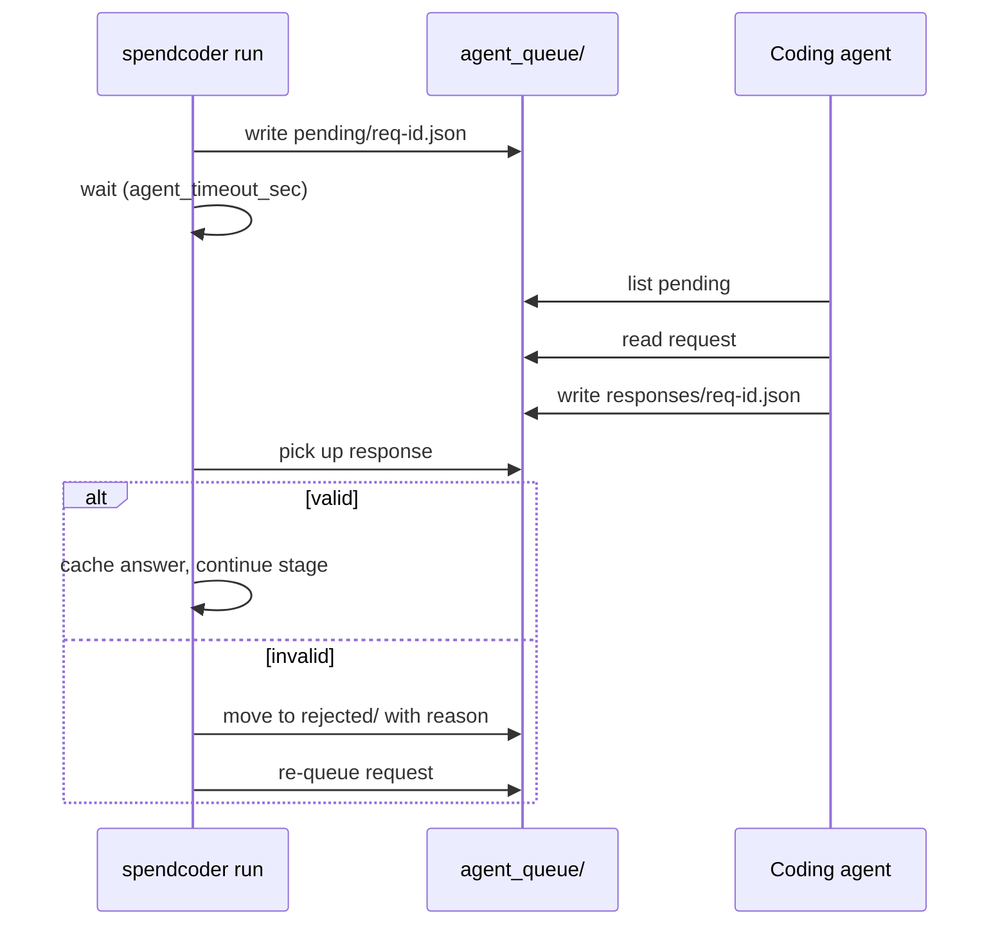

# Agent mode

Agent mode runs the whole pipeline with no API key. Instead of calling a model over HTTP, spendcoder writes each model call to disk as a JSON request. A coding agent such as Claude Code, Codex, or Cursor reads the request, writes an answer, and the pipeline picks it up and validates it exactly as it would validate an API answer.

```toml
# spendcoder.toml
[llm]
backend = "agent-files"
agent_work_dir = "runs/agent_queue"   # default
agent_timeout_sec = 7200
```

Or per command: `spendcoder run --backend agent-files`.

Use it when you do not want to manage an API key, or when you want a person or a local agent in the loop and the data kept inside an environment you already trust.

## Directory layout

```text
runs/agent_queue/
├── pending/      # requests waiting for an answer
├── responses/    # answers written by the agent
├── rejected/     # answers that failed validation, with the reason
└── done/         # requests that have been answered
```

## Lifecycle



1. The pipeline reaches a model step and writes `pending/<id>.json`.
2. The run blocks on that request, up to `agent_timeout_sec`.
3. The agent answers by writing `responses/<id>.json` as `{"id": "<id>", "output": ...}`, or by running `spendcoder queue answer <id> <file>`, which validates the file and then writes that response.
4. The pipeline validates the answer with the same validators the API backends use.
5. A valid answer is used and the stage continues. The request moves from `pending/` to `done/`, and the response stays in `responses/`. An invalid response is moved to `rejected/` with the validation error. The request stays in `pending/` so the agent can answer it again.

The ID is the purpose plus 16 hex characters of a hash of the request content, so identical questions share one answer.

## Protocol

Every request is a flat JSON object: an `id` (`<purpose>-<16 hex>`), the `kind` of call, the `purpose` (the stage name, such as `normalize`, `categorize`, `select`, `review_flags`, `review`), `created_at`, and the fields that kind needs (`system`, `user`, `schema`, `schema_name` for chat; `state`, `questions` for decisions; `prompt` for text). Two kinds need a structured answer, `chat` and `decision`. A third, `text`, is used only for GEPA reflection. The `output` value in a response file is the answer itself, and it is also what you pass to `queue answer` as the file contents.

The examples below show the shape. All data is synthetic.

### Chat request

```json
{
  "id": "normalize-5f1c0a9e72b4d1aa",
  "kind": "chat",
  "purpose": "normalize",
  "created_at": "2026-10-27T15:04:11+00:00",
  "schema_name": "vendor_normalization",
  "system": "You standardize merchant names from corporate card statements. ...",
  "user": "{\"items\": [{\"key\": \"g0\", \"description\": \"SQ *HARBOR GRILL 0342\", \"note\": \"team lunch\"}]}",
  "schema": {
    "type": "object",
    "additionalProperties": false,
    "required": ["results"],
    "properties": {
      "results": {
        "type": "array",
        "items": {
          "type": "object",
          "additionalProperties": false,
          "required": ["key", "vendor"],
          "properties": {
            "key": {"type": "string"},
            "vendor": {"type": "string"}
          }
        }
      }
    }
  }
}
```

The answer is a JSON object that satisfies `schema`:

```json
{
  "results": [
    {"key": "g0", "vendor": "Harbor Grill"}
  ]
}
```

Unknown keys are rejected because the schema sets `additionalProperties: false`.

### Decision request

```json
{
  "id": "categorize-a83d1b7c09ee42f0",
  "kind": "decision",
  "purpose": "categorize",
  "created_at": "2026-10-27T15:04:19+00:00",
  "state": {
    "description": "SQ *HARBOR GRILL 0342",
    "note": "team lunch",
    "vendor": "Harbor Grill"
  },
  "questions": {
    "category": {
      "type": "choice",
      "instructions": "Which spending category best describes WHAT WAS PURCHASED ...",
      "criteria": {
        "Meals": "Restaurants and prepared food",
        "Fuel": "Vehicle fuel",
        "Unknown": "None of the listed categories clearly applies, or the evidence is too thin to tell."
      }
    }
  }
}
```

The answer is an object keyed by question ID. A `choice` answer names one of the criteria keys and gives a probability for each option:

```json
{
  "category": {
    "type": "choice",
    "choice": "Meals",
    "probabilities": {"Meals": 0.84, "Fuel": 0.02, "Unknown": 0.14}
  }
}
```

A `noul` question (the yes/no review flags) answers with the probability of yes:

```json
{
  "dispute": {"type": "noul", "noul": 0.03}
}
```

### Validation rules

| Check | Applies to | Failure |
|-------|-----------|---------|
| Valid JSON | All | Rejected. |
| Response is an object with an `output` key | All | Rejected. |
| Matches `schema` (types, enum, required, no extra keys) | `chat` | Rejected with the path of each error, up to eight. |
| Every question ID answered | `decision` | Rejected: `missing answer for 'category'`. |
| Answer `type` equals the question `type` | `decision` | Rejected. |
| `choice` is a key of `criteria` | `decision` | Rejected: `choice 'Misc' is not an option`. |
| `noul` is a number in [0, 1] | `decision` | Rejected. |
| `score` is numeric | `decision` | Rejected. |

Stage-level checks still apply on top. A review answer that picks a rule outside `legal_options` leaves the group unresolved, and a category choice below `category_min_confidence` is gated, as with an API model. Probabilities should sum to roughly 1, because the confidence gate reads the probability of the chosen option. If `probabilities` is missing, a `confidence` number is used instead.

### Rejection

A rejected response is moved to `rejected/<id>.<n>.json`, where `n` counts earlier rejections of the same request. The file keeps the original content and adds an `error` field. The request stays in `pending/` so the agent can answer again:

```json
{
  "id": "categorize-a83d1b7c09ee42f0",
  "output": {"category": {"type": "choice", "choice": "Misc"}},
  "error": "category: choice 'Misc' is not an option"
}
```

The pipeline never repairs an answer.

## CLI helpers

```bash
spendcoder queue list                    # pending requests: id, kind, purpose, created_at
spendcoder queue show <id>               # print one request
spendcoder queue answer <id> answer.json # validate and submit an answer file
```

`queue answer` runs the same validation as the pipeline. An invalid file is reported immediately and nothing is written to `responses/`.

## Resume

Stored responses act as the cache. Each one stays in `responses/` under its request ID, and a rerun reads it before writing a new request. If the run stops (timeout, closed terminal, error-rate gate), start it again with the same command:

- Requests already answered are served from `responses/`, so the rerun costs nothing for them.
- Requests still in `pending/` are picked up again.
- Only unanswered work remains.

Changing a prompt component or the category list changes the request content and so its ID, which means affected questions are asked again. Unchanged ones are not.

## Driving it from a coding agent

Start the run in one terminal (or as a background process) and point the agent at the queue in another.

```bash
spendcoder run --backend agent-files --limit 50
```

The repository includes a ready-made skill at `skills/spendcoder/SKILL.md`. Copy it into your agent's skills location, for example `.claude/skills/spendcoder/` for Claude Code, and then give a prompt like:

```text
Process the spendcoder queue in ./demo. Run `spendcoder queue list`, read each
pending request with `spendcoder queue show <id>`, write the answer to a file,
and submit it with `spendcoder queue answer <id> <file>`. Follow each request's
schema exactly. If an answer is rejected, read the error and fix it.
```

For Codex, Cursor, or any other agent, paste the same instruction into the agent's instructions or rules file. The agent needs only shell access and file read and write in the project directory.

Tips:

- Use `--limit N` for a first pass so the agent answers a small batch and you can inspect `rejected/`.
- Vendor normalization requests batch up to `normalize_batch_size` descriptors (default 40) in one file.
- Decision requests are one per group of identical rows: the same description, note, and vendor for `categorize`, the same vendor, category, note, and candidate rules for `select`, and the same note and vendor for `review_flags` (only rows with a note). Ask the agent to answer them in one sweep rather than one at a time.
- Tell the agent to answer from the evidence in the request and not to look anything up. Web evidence comes through Parallel Search if you enable it.

## Safety notes

- An agent has no more authority than an API model, because it passes through the same validators and gates. It cannot pick an illegal rule, invent a category, write a GL code, or change an amount, since those are checked or computed in code.
- Request files contain statement text and memos written by third parties. The prompts tell the model to treat them as data, but an agent with shell access is a stronger target than a text-only API call. Run it in a directory with no secrets, restrict its tools to the project folder, and do not give it network or deploy credentials.
- The agent should not edit policy or the input. Instruct it to touch only `runs/agent_queue/`. Hashes in `manifest.json` will show if policy or input changed between runs.
- Request files contain your transaction text. Treat `runs/agent_queue/` as sensitive and delete it when you are done.
- Agent answers are not calibrated the way a Decisions model is, and self-reported probabilities are worth less. Keep `category_min_confidence` and review flags on, and sample the output.
- The manifest records which backend produced a run.
