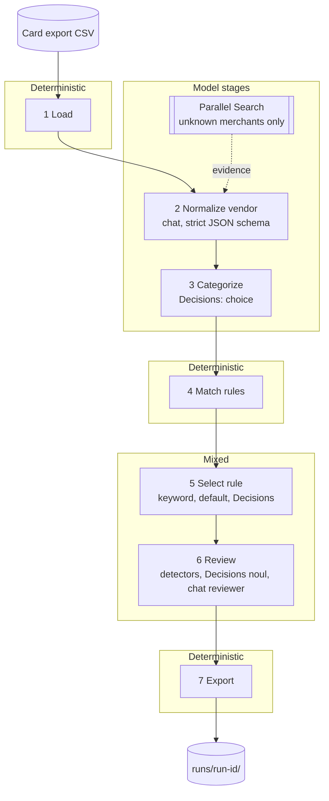
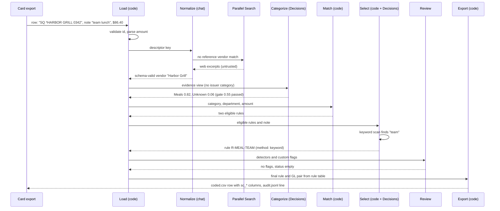

# Architecture

spendcoder is a seven-stage pipeline. Each stage reads and writes a list of `Txn` objects, and each stage is either deterministic code or a bounded question to a model whose answer is validated before use.

The governing rule is that models make judgments and code makes decisions. A model may say what a merchant is, what category a purchase falls under, which of several already-eligible rules fits best, and whether a group of rows looks wrong. Code decides which rules are eligible, which GL pair is posted, which amounts are in range, and that every input row comes out the other side.

## Contents

- [Pipeline overview](#pipeline-overview)
- [Stages](#stages)
- [Data model](#data-model)
- [Validation gates](#validation-gates)
- [Error handling](#error-handling)
- [Caching](#caching)
- [Determinism](#determinism)
- [One transaction, end to end](#one-transaction-end-to-end)
- [Security notes](#security-notes)

## Pipeline overview



## Stages

### 1. Load

Maps your export's headers to the canonical fields through `[dataset.columns]`:

| Field | Required | Notes |
|-------|----------|-------|
| `id` | yes | Must be non-empty and unique. A duplicate or empty ID aborts the load with the line number. |
| `description` | yes | The card statement text. |
| `amount` | yes | Parsed from strings like `$1,234.50` or `(45.00)`. `amount_sign` flips the sign for exports that report charges as negatives. Any unparseable amount aborts the load and lists the first ten line numbers. |
| `date` | no | Carried through. |
| `note` | no | The cardholder memo. |
| `department` | no | Used by rule eligibility. |

The delimiter is sniffed (`,` `;` tab or `|`), and the file must be UTF-8. Every original column is kept in `Txn.raw` and written back in its original order. The input file is never modified. If the input already contains any `sc_*` output column, the export step refuses to run, which prevents re-coding an already coded file by accident.

### 2. Normalize vendor

Statement descriptors are noisy: processor prefixes, store numbers, cities. This stage produces a clean merchant name per row.

1. Rows with the same description and note form one group, and each group becomes one item in a batch.
2. A token-overlap match against `vendors.txt` produces a `reference_vendor` hint. A single-token vendor must match fully. A multi-token vendor needs at least 60% of its tokens.
3. If there is no reference match and `[search] provider = "parallel"`, spendcoder calls the Parallel Search API (`POST https://api.parallel.ai/v1/search`, mode `fast` by default) and attaches short web excerpts as evidence. Lookups run once per descriptor family. A family is a normalized key that drops processor prefixes (`SQ *`, `TST*`, `PP*`), store numbers, and punctuation, and keeps the first three tokens, so `SHELL #4567` and `SHELL 0021` share a key. Results are cached and the call is best-effort: a failure means no evidence and the run continues. Excerpts are untrusted text.
4. Items are sent to a chat model in batches (`normalize_batch_size`, default 40) with a strict JSON schema. A batch whose call or answer fails leaves its items on the fallback vendor. An item missing from an otherwise valid answer also falls back.

`vendor_method` records how the vendor was set: `model`, or `fallback` when the model gave nothing usable. The fallback is the reference vendor if there is one, otherwise the raw descriptor.

### 3. Categorize

One OpenRouter Decisions API call per group of rows with an identical description, note, and vendor (`POST /api/alpha/decisions`). The question is a `choice` whose options are your categories plus `Unknown`, and whose criteria are the category guide, one description per category. The API returns a probability for each option.

Order of precedence:

1. A `vendor_overrides.csv` hit sets the category directly (`category_method = override`). No model is called.
2. Otherwise the model's top choice is used if its probability is at least `category_min_confidence` (default 0.55), recorded as `decision`. If the top choice is Unknown, the category stays blank and the method is also `decision`.
3. Below the gate, the row stays Unknown and is recorded as `gated`.
4. If the call fails, the category is blank and the method is `error`.

The model sees `description`, `note`, `vendor`, and any `web_evidence`. Department, amount, and the issuer's own category are withheld.

### 4. Match rules

Pure code, in `Policy.eligible`. A rule is eligible when all of these hold:

- Its category equals the row's category, case-insensitively.
- Its `department` is blank or equals the row's department.
- The row's department is not in `excluded_departments`.
- The row's absolute amount falls inside `amount_range`, inclusive. A blank range matches anything. A NaN amount never satisfies a ranged rule. Refunds match like charges because the range is applied to the absolute value.

A row with a blank category or no eligible rules gets `select_method = none` and goes to review. One eligible rule is final (`select_method = unique`).

### 5. Select rule

When several rules are eligible, selection goes through three tiers and stops at the first that resolves:

1. Keyword. A case-insensitive match of a rule's keywords against the note only (the description is not searched), plus any aliases from `[policy.keyword_aliases]` (for example `HH` for happy hour). Keywords of three characters or fewer match whole words only. Longer ones match as substrings. If exactly one rule matches, it wins.
2. Default. If no keyword matched and exactly one eligible rule has no keywords, that rule is the default for its scope.
3. Decisions. A `choice` question restricted to the eligible rules, asked once per group of rows with the same vendor, category, note, and eligible rules. Each option shows its GL name, GL code, and keywords. A top choice below `select_min_confidence` (default 0.50) is gated and goes to review.

`select_method` is one of `unique`, `keyword`, `default`, `decision`, `gated`, `error` (the call failed), or `none`.

### 6. Review

Review groups suspect rows by vendor, category, note, description, and eligible rule set. Every row in a group has the same legal options, so one decision covers the whole group.

Deterministic detectors flag a row when:

- no rule was eligible,
- the category is Unknown,
- selection was gated or failed,
- selection confidence is below `[review] low_confidence`,
- the note names a GL account different from the selected rule.

Your own flags come from `[[review.flags]]` in `spendcoder.toml`. Each is a yes/no question asked through the Decisions API as a `noul` question (a probability that the answer is yes). The question is asked once per group of rows with the same note and vendor, and only for rows that have a note. A flag fires when the probability is at least its `threshold`. If the call fails, the row gets `flag_check_failed`.

```toml
[[review.flags]]
name = "dispute"
question = "Does the note indicate this charge is disputed, fraudulent, or being refunded?"
threshold = 0.5
action = "review"     # or "hold"

[[review.flags]]
name = "personal_spend"
question = "Does the evidence suggest a personal rather than business purchase?"
action = "hold"
```

`action = "review"` sends the group to the reviewer. `action = "hold"` marks the row unresolved so a person must look, with no model override possible.

Flagged groups go to a chat reviewer in batches of 25 groups. For each group it must return one of three actions:

| Action | Meaning | Constraint enforced by code |
|--------|---------|-----------------------------|
| `keep` | Current rule is right. | None. |
| `change` | A different rule is better. | `rule_id` must be in `legal_options`, the rules eligible for every row in the group. |
| `unresolved` | A person must decide. | None. |

An answer that names an illegal rule is rejected and the group is marked unresolved. A group the reviewer did not answer is also unresolved. `review_status` ends as `kept`, `changed`, or `unresolved`, and `final_rule_id`, `final_gl_code`, `final_gl_name` carry the outcome.

### 7. Export

Writes five files to `runs/<run-id>/`:

| File | Contents |
|------|----------|
| `coded.csv` | Original columns in original order, then the `sc_*` columns. Written to a temp file and renamed, so a crash never leaves a half-written output. |
| `review_queue.csv` | Rows that are unresolved or have no final GL, with reasons. |
| `audit.jsonl` | One JSON object per row with the decision lineage: which method decided each stage, with confidences and reasons. |
| `manifest.json` | Hashes of the input, policy files, and prompt components; models used; call counts by purpose; token counts; cache hits; cost in USD. |
| `summary.md` | Counts by category method, rule selection method, review status, and flag, plus model calls, cost, and duration. |

## Data model

`Txn` is the unit that moves through the pipeline.

| Field | Set by | Meaning |
|-------|--------|---------|
| `id`, `description`, `amount`, `note`, `department`, `date` | Load | Canonical inputs. |
| `raw` | Load | Original row, all columns. |
| `vendor`, `vendor_method` | Normalize | Clean merchant and how it was derived. |
| `web_evidence` | Normalize | Search excerpts, if any. |
| `category`, `category_confidence`, `category_method` | Categorize | Empty string means Unknown. Methods: `decision`, `override`, `gated`, `error`. |
| `candidates` | Match | Eligible rule IDs. |
| `rule_id`, `gl_code`, `gl_name` | Match, Select | The chosen rule and its GL pair. |
| `select_method`, `select_confidence`, `select_reason` | Match, Select | How the rule was chosen. |
| `flags` | Review | Names of detectors and custom flags that fired. |
| `review_status`, `review_reason` | Review | `kept`, `changed`, `unresolved`, or empty. |
| `final_rule_id`, `final_gl_code`, `final_gl_name` | Review | What to post. |

`Txn.evidence_view()` is the only view a model receives: description, note, department, amount, vendor, category, and web evidence. It never includes the issuer's own coding.

The output columns, appended after your originals, map one to one:

`sc_vendor`, `sc_vendor_method`, `sc_category`, `sc_category_confidence`, `sc_category_method`, `sc_candidate_rules`, `sc_rule_id`, `sc_gl_code`, `sc_gl_name`, `sc_select_method`, `sc_select_confidence`, `sc_select_reason`, `sc_flags`, `sc_review_status`, `sc_review_reason`, `sc_final_rule_id`, `sc_final_gl_code`, `sc_final_gl_name`.

Floats are written with three decimals. Lists are joined with `|`.

## Validation gates

Nothing a model returns is used until it passes a gate in `llm/base.py` or a stage.

| Gate | Where | Rule |
|------|-------|------|
| JSON schema | Chat answers | Subset validator: type, enum, required keys, and `additionalProperties: false`. Failure raises `InvalidAnswer`. |
| Decision shape | Decisions answers | Every question answered, with the declared type. `choice` must be one of the criteria keys. `noul` must be a number in [0, 1]. |
| Confidence | Categorize, select | Probability of the chosen option must meet the configured minimum, else the row is gated. |
| Key coverage | Normalize | Each requested key needs a vendor in the answer. A missing key falls back. |
| Rule legality | Select, review | The rule must be in the eligible set (for review groups, eligible for every row in the group). |
| GL pair | Export | The GL code and name come from the rule table, never from model text. |
| Row preservation | Export | Output IDs equal input IDs, in input order. |

Rejected answers are never repaired. The OpenRouter backend retries them, and if they still fail the affected rows fall back to a safe state: Unknown category, gated selection, unresolved review.

## Error handling

- Transient API errors are retried up to `max_retries` (default 4), with a per-call `timeout_sec`.
- A failed call does not abort the run by itself. The affected rows are marked (`category_method = error`, `select_method = error`, or the fallback vendor), and a missing category or rule sends them to review.
- The error-rate gate works per stage. If the share of failed calls in normalize, categorize, or select exceeds `[gates] max_error_rate` (default 0.05), the stage raises `StageError` and the run stops instead of exporting a mostly empty result. Normalize counts failed batches. Categorize and select count failed groups. Raise the limit deliberately if you want to export a degraded run.
- Unrecoverable backend failures (bad key, malformed request) raise `BackendError` without retrying, and the stage counts the call as failed.
- Config and policy errors are caught before any model call. `spendcoder doctor` runs the same checks on demand: duplicate categories or rule IDs, rules that reference unknown categories, missing GL fields, unreadable amount ranges, and missing files or columns. It also notes categories with no rules and scopes with several no-keyword default rules.

An unreadable `amount_range` is a hard error because the alternative is a rule that silently matches every amount.

## Caching

The OpenRouter backend caches responses on disk under `.spendcoder_cache/`, keyed by a hash of the full request: model, prompts, schema, and payload. The agent-files backend keeps answers in its queue folder, where they serve as the cache (see [agent-mode.md](agent-mode.md)). The consequences:

- Rerunning on the same input and the same prompts costs nothing.
- Changing a prompt component, a model, or a row's content invalidates exactly the affected entries.
- An interrupted run resumes from the cache with no special flag.
- `manifest.json` reports `cache_hits` next to live call counts, so you can see what a run actually spent.

Search results are cached the same way.

## Determinism

Code stages are deterministic given the same input and policy: ordering follows input order, tie-breaking is explicit, and no stage uses randomness. Model stages are deterministic for a given cache. A cold run against a live model is as repeatable as that model, which is why the manifest stores the input, policy, and prompt hashes next to the model names. The `mock` backend is fully deterministic and is what CI uses.

## One transaction, end to end



## Security notes

- API keys are read from the environment or a project `.env` (git-ignored) and are sent only to their own provider. They never appear in prompts, caches, run outputs, or the manifest.
- Descriptions, memos, and web excerpts are untrusted data that can contain instructions. The prompts tell the model to treat them as data, and no model answer can change policy: choices are limited to closed lists, legality is checked in code, and GL pairs come from the rule table.
- The issuer's own coding is not in `evidence_view`, so a model cannot copy a wrong upstream label and results do not depend on it.
- Web evidence is best-effort and bounded. Only unmatched merchants are searched by default (`only_unknown_merchants`), with a cap on results and characters per result. Search failures degrade to no evidence.
- Agent mode moves model calls into files on disk. Treat the queue directory like any other input boundary. See [agent-mode.md](agent-mode.md).
- In API mode, descriptions, memos, departments, amounts, and cleaned vendor names leave your machine for OpenRouter, and unmatched descriptors for Parallel. If that is not acceptable for your data, use agent mode with a local agent or the mock backend.
