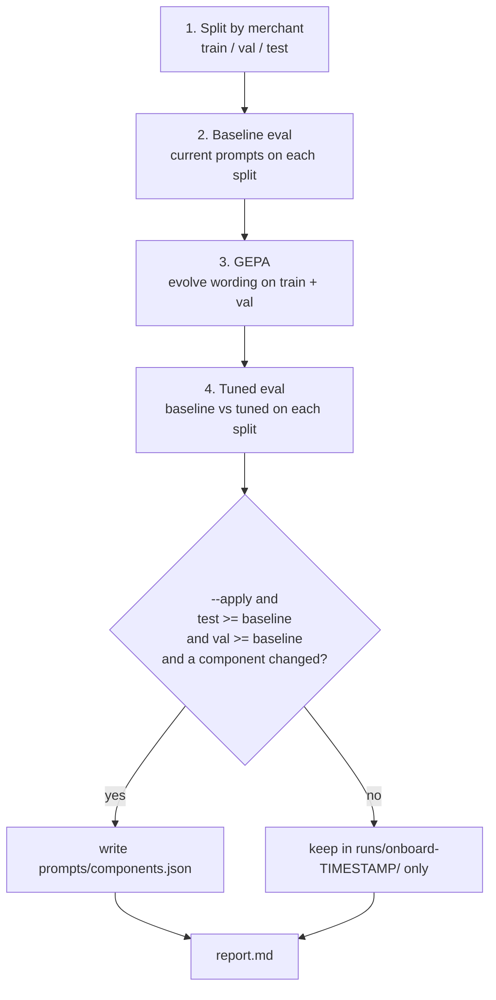

# Onboarding with GEPA

`spendcoder onboard` adapts the pipeline's prompt wording to your company's spend, using a labeled sample you provide. The optimizer changes how a question is asked. Your policy, including what is allowed, stays fixed.

```bash
spendcoder onboard --backend mock --apply      # offline, no keys
spendcoder onboard --apply                     # live, uses OpenRouter
spendcoder onboard --budget 150 --components category_guide,select_instructions
```

## The flow

Run `spendcoder doctor` before you onboard. `onboard` does not run it. Doctor validates config, policy, and data. It lists categories that have no rule and scopes with several default rules, and it flags labeled rows whose `expected_category` is not in `categories.csv`. Fix what it reports first, because no prompt can compensate for a policy that has no legal answer.



1. Split. Labeled rows from `data/labeled.csv` are divided into train, validation, and test.
2. Baseline. The current prompts are scored on each split.
3. GEPA. The text components evolve against train and validation.
4. Promotion. Baseline and tuned prompts are compared on the held-out test split and on validation.

## What GEPA is

GEPA (Genetic-Pareto) is a prompt optimizer that learns from natural-language feedback as well as a scalar reward. It runs your system on a minibatch, collects what happened, asks a reflection model to read the traces and propose better instructions, and keeps a pool of candidates. Selection is Pareto-based: a candidate stays in the pool if it is best on at least one validation example, which keeps diverse strategies in play instead of collapsing onto one average winner.

The paper is *GEPA: Reflective Prompt Evolution Can Outperform Reinforcement Learning* ([arXiv 2507.19457](https://arxiv.org/abs/2507.19457)). The implementation is at [github.com/gepa-ai/gepa](https://github.com/gepa-ai/gepa). spendcoder calls `gepa.optimize` with a custom `GEPAAdapter`.

GEPA suits this problem because sample counts are small. A person can label 100 rows. A wrong answer gives reflection more to work with than a reward number does: the feedback says what was expected, what was predicted, the confidence of the option the model chose, and which rules were eligible.

## Tunable and frozen

| Component | Tunable | Where it is used |
|-----------|---------|------------------|
| `categorize_instructions` | Yes (default set) | Question text of the category `choice`. |
| `category_guide` | Yes (default set) | Per-category descriptions that become the Decisions criteria. |
| `select_instructions` | Yes (default set) | Question text when several rules are eligible. |
| `review_system` | Optional | System prompt of the chat reviewer. |
| `normalize_system` | Optional | System prompt of vendor normalization. |

Choose components with `--components a,b` or `[tune] components` in `spendcoder.toml`. The three default components affect the most rows and are cheapest to evaluate. Add `normalize_system` or `review_system` only if your labeled set exercises them. The score measures category and GL, so improvements there show up only indirectly.

Frozen, always:

- Categories and the rule matrix.
- Eligibility, amount ranges, department exclusions, and GL pairs.
- Confidence gates and thresholds.
- Output schemas and validation.
- Vendor overrides and keyword matching.

Tuned components are plain strings in `prompts/components.json`. You can read and edit them.

## The adapter

GEPA calls two methods on the adapter.

`evaluate(batch, candidate, capture_traces)` runs the real pipeline on a batch of labeled rows using the candidate's components. The review stage is skipped. It returns one score per example, plus per-example trajectories when asked: the row, the vendor, the category and its confidence, the eligible rules, the predicted rule, and the expected values.

`make_reflective_dataset(candidate, eval_batch, components_to_update)` turns trajectories into records for the reflection model, one list per component being updated. Each record has four parts:

| Key | Content |
|-----|---------|
| `Inputs` | What the model saw: description, note, department, amount, vendor, and web evidence if present. |
| `Generated Outputs` | What the pipeline produced: category and its confidence, eligible rules, selected rule, GL code. |
| `Feedback` | Plain text: expected vs predicted category and GL, the confidence of the chosen option, the allowed categories, and the rules eligible for the expected category. |
| `Expected` | The labeled category and GL code. |

A feedback line looks like this (synthetic):

```text
category: expected 'Fuel', got 'Meals'; GL: expected 5210, got none via none (eligible: none). category confidence was 0.61 (method: decision). allowed categories: Fuel, Meals, Office supplies. eligible rules for the expected category: R-FUEL-FIELD.
```

The reflection model reads these and rewrites the component text. With `backend = openrouter` the reflector is the chat model named by `reflection_model`. With `backend = mock` there is no reflection model. A deterministic `MockProposer` adds words from the note and vendor of failed examples to the expected category's line in `category_guide`, so the whole loop runs offline and in CI.

## Splitting

Labeled rows are split into train, validation, and test, by default 50 / 25 / 25 (`[tune] split`), with a fixed `seed`.

The split groups by merchant, using the same descriptor key (`descriptor_key`) as vendor normalization. All rows for `SHELL #4567` and `SHELL 0021` land in the same split. Without this grouping, a prompt can memorize a merchant from train and appear to generalize on a validation row that is the same merchant under a different store number.

With very few distinct merchants, split sizes will be uneven. The labeled set needs at least three distinct merchants, and the run stops with an error if it has fewer. Each split gets at least one merchant.

## Scoring

Per example, 1.0 total:

| Part | Weight | Condition |
|------|--------|-----------|
| Category | 0.5 | Predicted category equals `expected_category`. |
| GL | 0.5 | Final GL code equals `expected_gl_code`. |

The GL half is scored on the full pipeline result. A row with the right category and the wrong GL gets 0.5, and a row with the wrong category that still lands on the right GL also gets 0.5. Because the two halves are separate, the feedback shows whether a miss came from category wording or from rule selection.

## Invariants

Candidates from the optimizer are checked before they are scored:

- The `category_guide` must list every category exactly once. A candidate that drops, duplicates, or invents a category scores 0.
- A candidate with component keys outside the tunable set also scores 0.
- Candidate text is used only as prompt wording. It has no path to rules, thresholds, or GL pairs.

GEPA can turn "Meals: food" into "Meals: prepared food and drink for staff or customers, including delivery platforms; bulk grocery runs belong elsewhere", but it cannot add a category or change which rules exist. A zero score also steers the search, since that lineage stops being selected.

## Promotion

| Condition | Result |
|-----------|--------|
| `--apply`, held-out test score >= baseline, validation score >= baseline, and at least one component changed | Tuned components are written to `prompts/components.json`. The previous file is backed up as `components.previous.json` in the run directory. |
| Any other case | `prompts/components.json` is left alone. |

Every run saves the tuned components as `components.tuned.json`, with `report.md` and `result.json`, in `runs/onboard-<timestamp>/`.

The test split is not used to pick a candidate. Be wary of a tie on a small set: on 25 test rows, one row is 4 points.

## Reading report.md

`runs/onboard-<timestamp>/report.md` has these parts.

1. Header. Backend, components, budget used, candidate count, seed, and split.
2. Split. Rows and merchants per split.
3. Scores. Baseline and tuned score, category accuracy, and GL accuracy on train, validation, and test. Look at the test row first. A large train gain with a flat test score means the prompts memorized.
4. Decision. Whether the tuned components were promoted, and why.
5. Candidate lineage. Which candidate descended from which, with validation score and the components that changed. A long chain of small wins is healthier than one jump.
6. Component changes. A diff of baseline against tuned text for each changed component. Read this. If a tuned category description mentions one specific merchant, that is overfitting to your sample and you should generalize it by hand.
7. Run metadata. Model usage for the run.

Re-run `spendcoder eval` any time to score whatever prompts are currently in `prompts/components.json`.

## Example run (mock backend)

This run used the `acme` demo project with `spendcoder onboard --backend mock --budget 150`.

| Split | Baseline score | Tuned score |
|-------|----------------|-------------|
| Train | 0.314 | 0.500 |
| Validation | 0.406 | 0.438 |
| Test | 0.310 | 0.310 |

Train improved and test stayed flat. The mock proposer appends words from failed examples to a category's description, and those words do not carry over to merchants it has not seen. The run shows that the loop works. It says nothing about accuracy on real data.

## Cost control

- Start with `--backend mock` to check that your labeled file, columns, and policy are wired up. It is free.
- Use `--budget N` (`max_metric_calls`, default 300). Each metric call is one labeled row evaluated by the real pipeline. Try 150 for a first look. On the acme demo, a budget below about 100 is too small to show any change, because the validation evaluation uses most of it.
- Responses are cached by content hash. Re-running with the same candidate costs nothing, so repeated onboarding after small policy edits is cheaper than the first run.
- Tune one or two components at a time with `--components`.
- Keep `minibatch_size` small (default 6) so each reflection step is cheap.
- Run `spendcoder eval` before `onboard`. If the baseline is already near ceiling, tuning will not help, and the money is better spent on more labels or a policy fix.
- Check the Decisions model with `spendcoder models`. Cheaper models are often fine for categorization.

## Writing a good labeled set

The file is `data/labeled.csv`, with the same columns as your export plus:

| Column | Meaning |
|--------|---------|
| `expected_category` | A name from `categories.csv`. |
| `expected_gl_code` | The GL code a careful person would post. |

Guidance:

- Use 50 to 200 rows. Under 50 the test split is too small to trust. Over 200 the marginal row buys less than fixing the policy.
- Cover every category and every rule at least a few times, including the rules selected by keyword and the rare ones.
- Include hard cases on purpose: ambiguous merchants (a hardware store buying fuel), memos that override the merchant's usual industry, the same merchant with different departments, amounts just above and below range edges, and rows that should be Unknown.
- Prefer many merchants with one to three rows each over a few merchants with many rows. The split is by merchant, so repeats add little.
- Label from your policy and the evidence, not from the model's output. Record who labeled and when, and have a second person check the disputed rows. Labels copied from a previous automated run only teach the optimizer to reproduce that run.
- If two reasonable people disagree on a row, settle it in the policy or leave it out. The optimizer cannot resolve a disagreement in the labels.
- Use rows you are allowed to send to the chosen model provider, or onboard through agent mode or the mock backend.
- Add the rows a human corrected from the review queue. That is the cheapest source of realistic hard cases.
